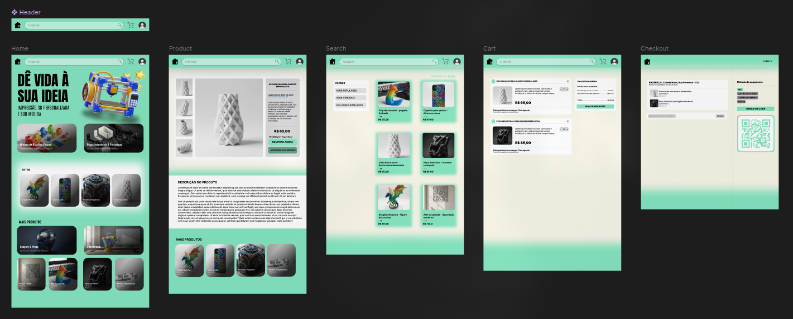

# 3D Printer E-commerce

A 3D Printer E-commerce é um e-commerce online feito em HTML5, CSS3 e JavaScript como avaliação parcial da disciplina de Interface Homem Máquina do curso de Tecnologia em Análise e Desenvolvimento de Sistemas do IFBAIANO - Campus Guanambi

## Estrutura

O projeto é divido em 5 telas, sendo: Home, produto, pesquisa, carrinho e checkout. Cada tela pode ser acessada diretamente na navegação do site, simulando um site real de ecomerce:
```
.
├── carrinho
├── checkout
├── home
├── pesquisa
├── produto
└── README.md
```

## Prototipação

O site foi préviamente prototipado usando Figma, seguindo padrões de IHM como teoria das cores e affordance:


